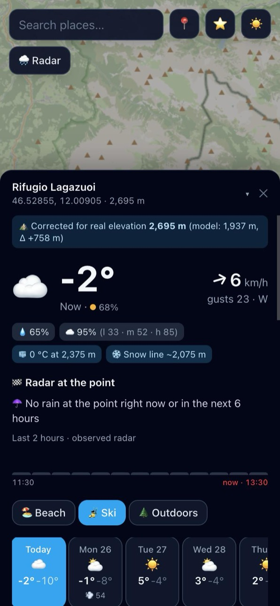
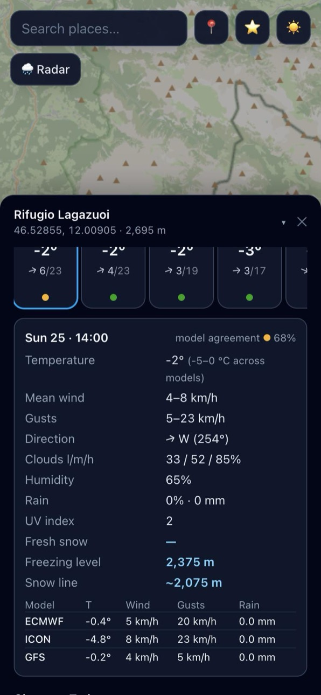
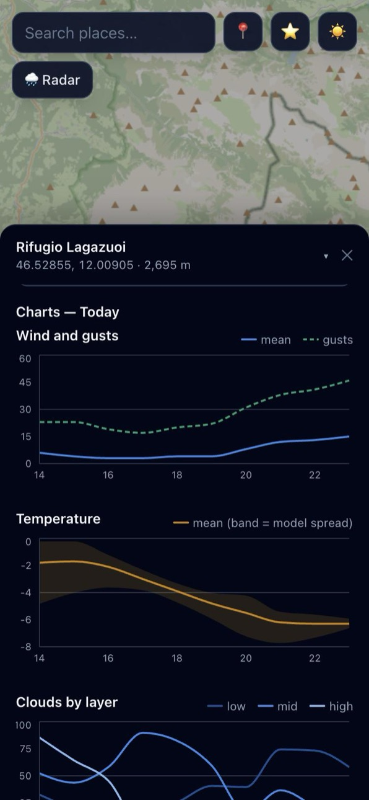
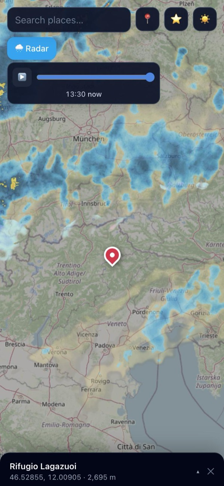

# Wee — hyperlocal weather ⛰️

[](../../actions/workflows/ci.yml)
[](LICENSE)


**A weather forecast for the exact GPS point you tap on the map — not for the nearest town.**

Weather models work on grid cells several kilometres wide, so a mountain hut at 2,700 m and the valley below often get the same forecast. Wee corrects the forecast for the real elevation of the point, compares three global models to show how much they agree, and tells you whether it is raining on that exact spot right now. It is built for beach days, skiing and hiking.

**[▶ Live demo](https://migr17.github.io/wee/)** · installable as an app on iOS and Android · no account, no API keys, no backend

<table>
  <tr>
    <td></td>
    <td></td>
    <td></td>
    <td></td>
  </tr>
  <tr>
    <td align="center"><sub>Elevation-corrected forecast</sub></td>
    <td align="center"><sub>ECMWF vs ICON vs GFS</sub></td>
    <td align="center"><sub>Charts with model spread</sub></td>
    <td align="center"><sub>Rain radar</sub></td>
  </tr>
</table>

## Features

- **Tap anywhere on a full-screen map** (Leaflet + OpenStreetMap) to get a forecast for that point. You can also search for a place or use your current location.
- **Elevation correction.** Compares the real elevation of the point (Copernicus DEM) with the elevation of the model grid cell and adjusts temperatures with the standard lapse rate. A badge always explains what was done: *"Corrected for real elevation 2,695 m (model: 1,937 m, Δ +758 m)"*.
- **Multi-model confidence.** ECMWF, ICON and GFS are fetched in a single request. Every hour gets an agreement score from 0 to 100 % (green / yellow / red) and shows the min–max spread across models, e.g. "wind 15–28 km/h depending on the model".
- **Point radar.** Samples the RainViewer radar tiles at the exact pixel of the point over the last 2 hours ("raining now", "stopped ~20 min ago"). It also shows a 15-minute precipitation forecast for the next 6 hours with a countdown: "rain in ~30 min".
- **Activity modes** (beach 🏖️ / ski 🎿 / outdoors 🌲) with their own alert thresholds and highlights: UV and sunshine hours for the beach; fresh snow, freezing level, cold and lift-closing wind for skiing; rain, gusts and cold for hiking.
- **7-day view** with hourly cards and charts: temperature with model spread, wind and gusts with direction, low / mid / high clouds, rain and probability, freezing level, snow line, UV.
- **Saved places** stored locally, with live previews and JSON export / import.
- **Offline-ready PWA.** Installable on the home screen; the last forecast stays available offline, clearly labelled with when it was updated.

## How it works

### Elevation correction

Requests to Open-Meteo use `elevation=nan`, which disables the provider's own downscaling. The response then reports the **mean elevation of the model cell**, and the app applies a transparent, unit-tested correction using the real elevation from the Elevation API:

```
T_point = T_model − 0.0065 °C/m × (elevation_point − elevation_cell)
```

The snow line is estimated at ~300 m below the freezing level. If the elevation service is unavailable, the forecast is still shown, uncorrected, and the badge says so.

### Confidence index

For every hour, each variable contributes a score between 0 and 1 based on the spread (max − min) between models, normalised against a threshold beyond which agreement is considered zero:

| Variable | Zero-agreement spread |
|---|---|
| Temperature | 6 °C |
| Wind | 20 km/h |
| Precipitation | 4 mm/h |

The hourly confidence is the mean of the available scores. Variables that a model doesn't provide are skipped: for example ECMWF has no freezing level and only GFS provides UV.

### Point radar

The RainViewer tile containing the point is fetched at zoom 7 for each radar frame and drawn on an off-screen canvas. A 5 × 5 pixel neighbourhood (~2 km) is classified against the *Universal Blue* palette into none / light / moderate / heavy. This is best effort: if tiles can't be read, the section simply disappears.

## Tech stack

**React 19** · **TypeScript (strict)** · **Vite** · **Tailwind CSS 4** · **Leaflet / react-leaflet** · **Recharts** · **vite-plugin-pwa (Workbox)** · **Vitest** · **oxlint** · **GitHub Actions**

All data comes straight from free public APIs called from the browser.

## Project structure

```
src/
  api/         typed HTTP clients: Open-Meteo (multi-model forecast, 15-min, elevation),
               RainViewer, Nominatim, plus an in-memory promise cache
  lib/         pure, unit-tested logic: elevation correction, confidence index,
               multi-model aggregation, activity thresholds, radar sampling, 15-min outlook
  components/  map, search, radar control, forecast panel, charts, saved places
  hooks/       useForecast, useSavedPoints, useRadar, useTheme
scripts/       dependency-free PNG icon generator for the PWA
```

Alert thresholds for each activity live in a single config object: [`src/lib/activities.ts`](src/lib/activities.ts).

## Getting started

Requires Node.js 20.19+ (22 LTS recommended).

```bash
git clone https://github.com/migr17/wee.git
cd wee
npm install
npm run dev        # http://localhost:5173
```

| Command | What it does |
|---|---|
| `npm run dev` | Start the dev server |
| `npm test` | Run the unit tests (Vitest) |
| `npm run lint` | Lint with oxlint |
| `npm run typecheck` | Type-check the project |
| `npm run build` | Production build in `dist/`, including the service worker |
| `npm run preview` | Serve the production build (needed to try install / offline mode) |
| `npm run icons` | Regenerate the PWA icons |

## Deployment

The build is a static site, so any static host works. PWAs require HTTPS, which all the options below provide.

- **GitHub Pages (included).** [`.github/workflows/deploy.yml`](.github/workflows/deploy.yml) builds and publishes on every push to `main`. One-time setup: *Settings → Pages → Source: GitHub Actions*. The workflow sets `BASE_PATH` to `/<repo-name>/` automatically.
- **Netlify / Vercel.** Import the repository and use build command `npm run build` with output directory `dist`.

## Data sources & attribution

| Data | Source | Terms |
|---|---|---|
| Forecasts (ECMWF IFS, DWD ICON, NOAA GFS), 15-min precipitation | [Open-Meteo](https://open-meteo.com/) | CC BY 4.0, free for non-commercial use |
| Elevation (Copernicus DEM GLO-90) | [Open-Meteo Elevation API](https://open-meteo.com/en/docs/elevation-api) | CC BY 4.0 |
| Rain radar | [RainViewer](https://www.rainviewer.com/api.html) | Free public API, attribution required |
| Map tiles and geocoding | [OpenStreetMap](https://www.openstreetmap.org/copyright) / [Nominatim](https://operations.osmfoundation.org/policies/nominatim/) | ODbL; usage policies respected (searches run on submit only, max 1 request/s) |

## Limitations

- The lapse-rate correction assumes a standard atmosphere. It does not model temperature inversions, which are common in valleys in winter.
- The public RainViewer API only provides observed frames (no radar nowcast), so short-term rain timing comes from the Open-Meteo model.
- Public OpenStreetMap tiles and Nominatim are meant for light usage. A high-traffic deployment should switch to a commercial tile and geocoding provider.

## Roadmap

- Multi-language support (i18n), starting with Italian
- Imperial units option
- Sunrise / sunset and daylight hours
- Wind and swell for water sports (Open-Meteo Marine API)
- Shareable links to a point (`?lat=…&lon=…`)

## License

[MIT](LICENSE) © Migr17
